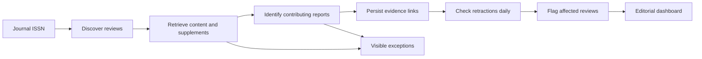

# ReviewGuard

**Automatic journal surveillance for retractions in the evidence used by systematic reviews and meta-analyses.**

ReviewGuard discovers reviews in a journal, retrieves accessible content, identifies source-backed contributing publications, stores those relationships, and checks them daily. A retraction creates an **editorial assessment required** case for the affected review. Editors record decisions in the local dashboard. Supported links do not require individual human approval or author spreadsheets.

**0.3.0a1 is a runnable research alpha.** The workflow works for supported structured content, but scientific accuracy and complete journal coverage are not qualified. Missing content or unresolved evidence stays visible as incomplete. The application never automatically contacts authors.

## The automated workflow



- **Discovery:** free Crossref journal API, a focused starting search, overlapping indexed-date updates and progressive backfile windows. No account or paid subscription is required. Optional legacy OpenAlex discovery remains available.
- **Retrieval:** DOI metadata, public publisher pages, Europe PMC open-access XML, observed supplements and licensed publisher PDF/XML links. Access failures remain visible.
- **Content assessment:** structured JATS citations and Springer/Nature HTML anchors are analyzed in section and sentence context. Explicit final-inclusion statements create automatic report links with exact evidence, locator, document hash and rule version. Citation ranges use actual bibliography labels. Merely being cited is insufficient.
- **Local AI:** bounded Ollama assistance for ambiguous evidence, defaulting to `qwen3:1.7b` for an 8GB M1 Mac. Its scientific quality is not qualified; experimental proposals cannot override the evidence rules. Automatic evidence linking works without Ollama.
- **Monitoring:** free Retraction Watch CSV plus Crossref notice relations. Retractions, concerns, corrections and reinstatements remain distinct. Failed refreshes preserve the last good data and a visible error.
- **Editorial decisions:** localhost dashboard with evidence, notice history, coverage and case decisions. Reading does not acknowledge a case; evidence changes reopen it. Editors decide scientific consequences.

## Start on your Mac

Requires Python 3.10 or newer, macOS or Linux, internet for public sources and space for local documents. The core uses Python's standard library; PDF extraction uses optional open-source `pdfplumber`.

```bash
python3 -m venv .venv
source .venv/bin/activate
python -m pip install -e '.[pdf]'
reviewguard doctor
```

On macOS you can instead double-click **Setup ReviewGuard.command**, then **Launch ReviewGuard.command**. Setup creates a local environment. It does not install a scheduler or start a backfile download.

For local AI, install [Ollama](https://ollama.com/download), then start its local-only server:

```bash
OLLAMA_NO_CLOUD=1 OLLAMA_NUM_PARALLEL=1 OLLAMA_CONTEXT_LENGTH=4096 ollama serve
```

In a second terminal, install the small local model:

```bash
ollama pull qwen3:1.7b
```

Run the journal workflow and open the dashboard:

```bash
source .venv/bin/activate
reviewguard monitor --config config/monitor.json
reviewguard serve
```

Open **http://127.0.0.1:8765**. Each monitor pass performs bounded discovery, retrieval, extraction, analysis, notice checks and dashboard export. Backfile processing continues across runs. Exit code 2 means an operational step is incomplete; inspect the report rather than assuming a clean result.

## Journal configuration

Edit `config/monitor.json`: choose a journal ISSN, `backfill_since` and resource limits. Multiple journals are supported. The configuration is saved in that deployment's data directory for subsequent daily jobs.

The default enabled pilot is **Scientific Reports, ISSN 2045-2322**. **Scientific Reviews, ISSN 3120-4953**, is preserved but disabled: its [official scope](https://www.nature.com/scirev/aims) excludes systematic reviews and meta-analyses.

Defaults: three reviews retrieved per pass, three backfile days per journal, four discovery pages per window, 100 contributing-report Crossref checks, three optional AI proposals, seven-day source refresh and 250 total public HTTP requests. A large journal backfile requires many passes. Focused search gives useful starting candidates but is not exhaustive discovery. Unclassified records remain in the journal ledger; they are not counted as screened negatives.

```bash
# Shared options precede the command.
reviewguard --data-dir ./journal-data --max-requests 500 monitor --config config/monitor.json
reviewguard --data-dir ./journal-data daily
reviewguard --data-dir ./journal-data serve
```

`RG_DATA_DIR` selects the default data location. Optional `RG_EMAIL` adds a contact address to API requests; no email is sent. `OPENALEX_API_KEY` is only needed for the optional legacy OpenAlex command. There is no paid-service fallback. Disable `ai.enabled` to run without Ollama.

## Schedule daily checks

After inspecting a first run, install the Mac user job:

```bash
reviewguard schedule --hour 9
```

This starts a pass when installed and schedules 09:00 in the Mac's local time zone. Leave the Mac logged in with internet access. Ollama must be running for AI assistance. Successful jobs are not repeated within 20 hours; incomplete jobs can retry. Cloning and setup do not activate this schedule.

```bash
reviewguard schedule --remove
```

See [operations](docs/OPERATIONS.md) for backups, logs, Linux scheduling and recovery. A seven-day unattended reliability trial is still required. Runtime data and downloaded articles stay local and are excluded from Git.

## Try the isolated demonstration

```bash
reviewguard --data-dir ./demo-data demo
reviewguard --data-dir ./demo-data/synthetic-demo serve --port 8766
```

The demonstration uses explicitly synthetic evidence and a synthetic retraction in a separate database. The full automatic journal pipeline is also tested offline in `tests/test_pipeline.py`, without human inclusion decisions.

## Current coverage limits

The accepted rule covers **explicit linked final-inclusion statements in supported structured Results sections**. It does not yet reconstruct complete study maps from forest plots, scanned or rotated tables, unstructured PDFs or all supplement layouts. Those files are retained and extracted where possible, while unsupported content stays incomplete. DOI-less contributions remain unresolved. Counts refer to distinct **report DOIs**, not independent studies or effect estimates.

Title/abstract candidate screening, provider indexing and article access all limit recall. Automatic evidence matches are machine assertions, separately labelled from human decisions. A generic AI judgment, citation or zero-case dashboard is not proof of an unaffected review.

The initial small model failed early classification smoke tests. Passing software tests is not scientific validation. See [validation](docs/VALIDATION.md), [architecture](docs/ARCHITECTURE.md) and [roadmap](docs/ROADMAP.md) for the qualification work still required before editorial reliance.

## Commands and development

`reviewguard --help` lists all commands. `extract`, `analyze`, `status`, `report`, `import-file`, `import-notices`, `decide-reference`, `decide-case` and `migrate-legacy` are available. `check` investigates all known bibliography DOIs; normal `monitor`/`daily` Crossref checks target contributing reports. Matching Retraction Watch records can also create inclusion-verification exceptions for unresolved bibliography entries.

`init` optionally imports the six public DOI samples used during development. **Journal monitoring requires no sample seeds.** Publisher PDFs, full text and real databases are not distributed in the source repository.

```bash
python -m unittest discover -s tests -v
python -m pip wheel . --no-deps --wheel-dir dist
```

GitHub Actions is configured for Python 3.10, 3.12 and 3.14 on Linux, plus 3.12 on macOS. Remote CI results can only be verified after publication. See [contributing](CONTRIBUTING.md), [security](SECURITY.md) and [change log](CHANGELOG.md). Intended repository: `babak-ghadirzadeh/ReviewGuard`.

## License and data provenance

New code is MIT licensed; see [LICENSE](LICENSE). The user's original code is preserved byte for byte in `legacy/retractionguard.py`, with its historical README. It is not the current entry point. No article full text, third-party dataset or model weights are relicensed by this repository.

[Crossref / Retraction Watch](https://www.crossref.org/documentation/retrieve-metadata/retraction-watch/) updates the downloadable dataset on working days. The application attempts daily checks; it cannot guarantee immediate or complete upstream notice coverage.
